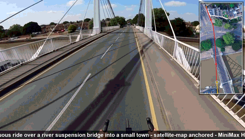
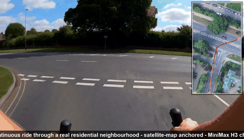
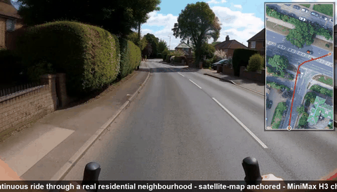
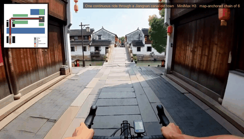
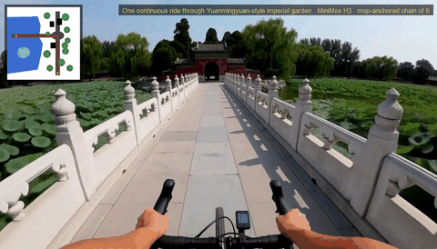

# 5090minimax-h3

**Map-anchored, one-shot (一镜到底) POV video generation on a frozen MiniMax H3 (FL2VA) model, driven through ComfyUI's HTTP API on a dual-RTX-5090 Windows box.**
用一张地图(手绘示意图,或**真实卫星截图**)当几何条件,逐段锚帧链接,产出 60 秒无缝一镜到底骑行视频;另含交互式方向盘伺服系统。模型权重不在本仓库(见下文 3)。本仓库对 AI agent 友好:管道每个环节都有可直接运行的脚本与真实 API 负载示例。

> Sister curated repo: [menyunlei/h3-map-anchored-video](https://github.com/menyunlei/h3-map-anchored-video) (tidy showcase). **This repo is the full working snapshot.**

## Highlights (click any clip for the full 60 s video)

**NEW: Crossing a British river suspension bridge into a small town** — from [`continuous_m2_v1.mp4`](continuous_m2_v1.mp4), conditioned on a real satellite screenshot (white pylons + fanned cables, box-junction hatches, moving left arc through the town junction):

[](continuous_m2_v1.mp4)

**Rolling 90° right turn at the real T-junction** — from [`continuous_m1_v1.mp4`](continuous_m1_v1.mp4), conditioned on a real satellite screenshot:

[](continuous_m1_v1.mp4)

**Same ride, opening leg** — quiet-street S-curve with the live-dot satellite minimap in the corner:

[](continuous_m1_v1.mp4)

**Cresting the stone arch bridge** — Jiangnan canal town, from [`continuous_r1_v2.mp4`](continuous_r1_v2.mp4):

[](continuous_r1_v2.mp4)

**Causeway across the lotus lake** — Yuanmingyuan-style park, from [`continuous_yym_v3.mp4`](continuous_yym_v3.mp4):

[](continuous_yym_v3.mp4)

---

## 1 · What's inside （给 AI 的地图）

```
*.py                     pipeline scripts (see §4 for exact run order)
build_jobs*_s1.py        ComfyUI workflow-JSON builders (the API payloads)
jobs*/                   GENERATED workflow JSONs — real, submittable API payloads
hop_specs*/              per-segment motion specs fed into the I2V chain
maps/                    conditioning maps (hand-drawn + real satellite, cleaned + route overlay)
continuous_*.mp4         DELIVERABLES: 4 finished ~60 s one-shot rides (Git LFS)
showreel_*.mp4           earlier experiment reels (Git LFS)
yym*_diag/, turn_analysis/   QC evidence: dense filmstrips, join-straddle sheets, minimap-dot checks
control_server.py        interactive steering server (click-map / WASD / self-play missions)
mission_report.md        self-play loop report (auto-eval + auto-fix of its own defects)
AGENTS.md                operational playbook for AI agents (read this first if you are one)
```

## 2 · Headline results

| Deliverable | Conditioning | Join diffs (/255) vs motion baseline | Notes |
|---|---|---|---|
| `continuous_m1_v1.mp4` | **real satellite screenshot** | 3.77–6.99 vs 20.05 | UK residential street; rolling 90° turn at the real T-junction; zero aerial collapse |
| `continuous_r1_v2.mp4` | hand-drawn Jiangnan canal-town map | 3.78–5.39 vs 34.39 | moving-dot minimap customer fix included |
| `continuous_yym_v3.mp4` | Yuanmingyuan-style park map | 3.98–6.04 | the original 60 s one-shot baseline |
| `continuous_yym_v4_mapeveryhop.mp4` | map re-fed every hop | 44–51 on 2 joins | perfect map-following, loose joins → **conditioning-channel split** finding |

## 3 · Prerequisites (checkpoints NOT included)

ComfyUI (desktop install) + models placed in the shared models dir:

- `minimax_h3_fl2va_pruned_int8_convrot.safetensors` (UNet)
- `minimax_h3_fl2v_turbo_8step_v1.0_comfyui_bf16.safetensors` (LoRA — note: 8-step turbo mutes audio)
- `qwen3vl_32b_minimax_h3_nvfp4_awq.safetensors` (CLIP)
- `minimax_h3_video_vae_int8_convrot.safetensors`, `minimax_h3_audio_vae_fp32.safetensors` (VAE)

Custom nodes: MiniMax H3 FL2VA nodes (`MiniMaxH3ReferenceToVideo`, `MiniMaxH3ImageToVideo`). Python side: `av`, `Pillow`.

Launch the compute instance (GPU1; NEVER compute on the display GPU under RDP):

```bat
.venv\Scripts\python.exe main.py --port 8189 --cuda-device 1 --vram-headroom 3.0 ^
  --models-directory <Shared>\models --input-directory <Shared>\input ^
  --output-directory <Shared>\output --temp-directory <Shared>\temp
```

## 4 · Pipeline quickstart (real commands, real order)

```bash
# 1. draw / clean a conditioning map        -> maps/M1_route.png
python draw_map_r1.py                      # hand-drawn example
# 2. build segment-1 Ref2V job JSON         -> jobs_m1/h3m1_s1.json
python build_jobs_m1_s1.py
# 3. submit (verify prompt_id in /queue afterwards!)
curl -s -X POST http://127.0.0.1:8189/prompt -H "Content-Type: application/json" --data-binary @jobs_m1/h3m1_s1.json
# 4. chain NEXT segment off the previous clip's ACTUAL last frame
python chain_extend.py h3m1_s1_00001_.mp4 m1_s1_last.png h3m1_s2 hop_specs_m1/s2.txt 243
#    ... submit, repeat through s6 ...
# 5. compile with fixed caption + moving-dot minimap
python compile_continuous_m1.py
# 6. verify: join diffs + straddle sheet + full strip + dot QC
python verify_m1.py && python strip_m1_full.py && python qc_m1_minimap.py
```

Interactive demo: `python control_server.py` → http://127.0.0.1:8787 (`/drive` = WASD real-time steering, `/mission` = self-play autopilot with per-hop auto-QC).

## 5 · Non-negotiable rules baked into every prompt/builder

1. **Ref2V = geometry, I2V = anchor.** Map enters only via `MiniMaxH3ReferenceToVideo`; pixel-exact continuity only via `MiniMaxH3ImageToVideo` first_frame. The one-hop-both fusion does not exist on H3 (paper finding: conditioning-channel split).
2. Each clip **cuts mid-motion at cruise speed**; turns are moving arcs inside clips; never stop-pan-go.
3. POV lock in every prompt: handlebar grips + rider hands always visible, 1.6 m camera, "no aerial view, no drone shot".
4. Conditioning maps must be **de-objected** (thin lines, hollow rings) or salient map graphics get painted into the world.
5. Real satellite maps: inpaint the app crosshair, then prompt *"aerial photograph used ONLY as a geometric route specification … NEVER reproduce the aerial viewpoint"*.
6. After every submit, confirm the `prompt_id` exists in `/queue` or `/history` — swallow happens during server restarts.

## 6 · Data note

Videos and stills are model-generated; the `maps/M1_*.png` satellite crops derive from a commercial map-app screenshot used strictly as route geometry. No real persons are depicted. Model checkpoints are deliberately excluded — see §3.
